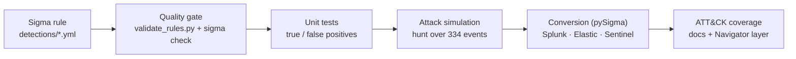

# Detection-as-Code Lab

[](https://github.com/nsatge1/detection-as-code-lab/actions/workflows/ci.yml)


A detection engineering pipeline where **SIEM rules are managed like code**.

Every rule is written in [Sigma](https://sigmahq.io), checked by a quality gate,
unit-tested against true-positive and true-negative events, replayed over a
simulated intrusion, converted to **Splunk, Elastic and Microsoft Sentinel** queries,
and mapped to **MITRE ATT&CK**. All of this runs automatically on every push.

## Why detection-as-code?

In many SOCs, rules are edited by hand in the SIEM console. Nobody knows who changed
what, a rule can break without anyone noticing, and noisy rules make analysts ignore
alerts. This lab applies software engineering practices to detections:

| Problem in the SOC | Answer in this repository |
|---|---|
| Rules change without review | Git history, pull request template, CI on every PR |
| A rule silently stops working | Each rule has events that **must** match (true positives) |
| Too many false positives | Each rule has look-alike events that must **not** match, plus 2,000 normal events with zero alerts allowed |
| Locked into one SIEM | One Sigma rule, converted to Splunk SPL, Elastic Lucene and Sentinel KQL |
| "What do we actually cover?" | ATT&CK coverage report and Navigator layer, generated from the rule tags |

## Pipeline



| Stage | Tool | Fails the build when... |
|---|---|---|
| Lint | `ruff` | Python code is not clean |
| Quality gate | [`scripts/validate_rules.py`](scripts/validate_rules.py) | metadata is missing, the `id` is not a unique UUID, there is no ATT&CK technique tag, the condition uses an unknown selection, or the rule has no test events |
| Sigma checks | `sigma check` | the rule breaks Sigma best practices or uses an ATT&CK tag that does not exist in the latest ATT&CK release |
| Unit tests | `pytest` + [`scripts/detection_engine.py`](scripts/detection_engine.py) | a true positive is missed or a true negative fires |
| Attack simulation | [`scripts/hunt.py`](scripts/hunt.py) | a rule does not fire on the intrusion, or any rule fires on normal activity |
| Coverage | [`scripts/coverage_report.py`](scripts/coverage_report.py) | `docs/` is out of date |
| Conversion | [`scripts/convert_rules.py`](scripts/convert_rules.py) | pySigma cannot convert a rule (queries are uploaded as a CI artifact) |

## Demo: hunting a simulated intrusion

[`samples/attack_simulation.jsonl`](samples/attack_simulation.jsonl) is one working day
of logs: 320 normal events (users, IT scripts, cron jobs, AWS API calls) and one full
intrusion. A finance workstation opens a malicious invoice, the attacker steals
credentials, prepares ransomware, then moves to AWS and to a Linux web server.

```console
$ make demo
Hunting with 14 rules over 334 events (samples/attack_simulation.jsonl)

TIME (UTC)            LEVEL     HOST               ATT&CK      RULE
--------------------------------------------------------------------------------------------------------------
2026-10-14 09:12:03   high      WIN-FIN-07         T1566.001   Office Application Spawns a Shell or Script Interpreter
2026-10-14 09:12:03   high      WIN-FIN-07         T1059.001   PowerShell Encoded Command Execution
2026-10-14 09:12:41   high      WIN-FIN-07         T1105       Certutil Used to Download a File
2026-10-14 09:13:10   medium    WIN-FIN-07         T1053.005   Scheduled Task Created to Run From a User-Writable Folder
2026-10-14 09:24:30   high      WIN-FIN-07         T1685       Microsoft Defender Protection Disabled With Set-MpPreference
2026-10-14 09:26:11   critical  WIN-FIN-07         T1003.001   LSASS Memory Dump With Comsvcs.dll MiniDump
2026-10-14 09:27:45   high      WIN-FIN-07         T1003.002   SAM, SYSTEM or SECURITY Hive Saved With Reg.exe
2026-10-14 09:31:02   medium    WIN-FIN-07         T1098       User Added to the Local Administrators Group With Net.exe
2026-10-14 10:41:00   high      WIN-FIN-07         T1490       Shadow Copies or Backup Catalog Deleted
2026-10-14 10:41:20   high      WIN-FIN-07         T1490       Shadow Copies or Backup Catalog Deleted
2026-10-14 10:42:05   high      WIN-FIN-07         T1685.005   Windows Security Audit Log Cleared
2026-10-14 11:05:12   medium    aws:111122223333   T1078.004   AWS Root Account Console Login
2026-10-14 11:07:40   high      aws:111122223333   T1685.002   AWS CloudTrail Logging Stopped or Trail Deleted
2026-10-14 13:30:09   medium    web-01             T1105       Remote Script Downloaded and Piped Into a Shell
2026-10-14 13:31:00   high      web-01             T1059.004   Linux Reverse Shell Using /dev/tcp

15 alerts | 1 critical, 10 high, 4 medium | 3 hosts/accounts
```

The normal events include traps on purpose: `vssadmin list shadows`,
`certutil -hashfile`, `reg query HKLM\SYSTEM`, a failed `StopLogging` (AccessDenied),
`curl ... | jq`. None of them raise an alert.

## Rules

14 rules for Windows, Linux and AWS, covering 15 techniques in 9 ATT&CK tactics.
Full catalog: [docs/coverage.md](docs/coverage.md).

| Rule | Level | ATT&CK |
|---|---|---|
| Windows Security Event Log Cleared With wevtutil | high | T1685.005 |
| LSASS Memory Dump With Comsvcs.dll MiniDump | critical | T1003.001 |
| PowerShell Encoded Command Execution | high | T1059.001, T1027.010 |
| Office Application Spawns a Shell or Script Interpreter | high | T1566.001, T1204.002 |
| Certutil Used to Download a File | high | T1105 |
| Microsoft Defender Protection Disabled With Set-MpPreference | high | T1685 |
| SAM, SYSTEM or SECURITY Hive Saved With Reg.exe | high | T1003.002 |
| Shadow Copies or Backup Catalog Deleted | high | T1490 |
| Windows Security Audit Log Cleared | high | T1685.005 |
| Linux Reverse Shell Using /dev/tcp | high | T1059.004 |
| AWS CloudTrail Logging Stopped or Trail Deleted | high | T1685.002 |
| Scheduled Task Created to Run From a User-Writable Folder | medium | T1053.005 |
| User Added to the Local Administrators Group With Net.exe | medium | T1098 |
| Remote Script Downloaded and Piped Into a Shell | medium | T1105, T1059.004 |
| AWS Root Account Console Login | medium | T1078.004 |

To see the coverage as a heat map, open
[ATT&CK Navigator](https://mitre-attack.github.io/attack-navigator/), choose
*Open Existing Layer* and upload [`docs/attack_navigator_layer.json`](docs/attack_navigator_layer.json).

> **ATT&CK v20:** the rules use the October 2026 version of ATT&CK, where *Defense
> Evasion* was split into **Stealth** and **Defense Impairment** (for example,
> "Clear Windows Event Logs" moved from T1070.001 to T1685.005). `sigma check` runs
> against the latest ATT&CK data in CI, so an outdated tag breaks the build.

## One rule, three SIEMs

[`proc_creation_win_rundll32_comsvcs_minidump.yml`](detections/windows/process_creation/proc_creation_win_rundll32_comsvcs_minidump.yml):

```yaml
detection:
  selection_dll:
    CommandLine|contains: 'comsvcs'
  selection_export:
    CommandLine|contains:
      - 'MiniDump'
      - '#24'
      - '#+24'
  condition: all of selection_*
```

`make convert` generates:

```text
# Splunk (Sysmon)
source="WinEventLog:Microsoft-Windows-Sysmon/Operational" EventCode=1 CommandLine="*comsvcs*" CommandLine IN ("*MiniDump*", "*#24*", "*#+24*")

# Elastic (ECS)
process.command_line:*comsvcs* AND (process.command_line:(*MiniDump* OR *#24* OR *#\+24*))

# Microsoft Sentinel / Defender XDR (KQL)
DeviceProcessEvents
| where ProcessCommandLine contains "comsvcs" and (ProcessCommandLine contains "MiniDump" or ProcessCommandLine contains "#24" or ProcessCommandLine contains "#+24")
```

## Quick start

```bash
git clone https://github.com/nsatge1/detection-as-code-lab.git
cd detection-as-code-lab
python3 -m venv .venv && source .venv/bin/activate
make install

make test       # unit tests + attack simulation
make validate   # quality gate + sigma check
make demo       # hunt over the simulated day
make convert    # write SIEM queries to build/queries/
make all        # the full CI pipeline, locally
```

## Add a new rule

1. Write the rule in `detections/<platform>/<log source>/<name>.yml`
   (copy an existing rule; generate a new `id` with `python3 -c "import uuid; print(uuid.uuid4())"`).
2. Create `tests/events/<name>.json` with at least one event in `should_match`
   and one look-alike event in `should_not_match`.
3. If the technique is new, add it to `TECHNIQUES` in `scripts/coverage_report.py`.
4. Run `make coverage` then `make all`, and open a pull request. CI does the rest.

## Project structure

```text
detections/                Sigma rules (windows/, linux/, cloud/aws/)
tests/events/              true-positive and true-negative events, one file per rule
tests/                     pytest suites: engine, rules, rule quality, attack simulation
samples/                   simulated attack day (JSON Lines)
scripts/
  detection_engine.py      small Sigma engine used to test rules without a SIEM
  validate_rules.py        quality gate
  convert_rules.py         Sigma -> Splunk / Elastic / Sentinel with pySigma
  coverage_report.py       ATT&CK coverage report + Navigator layer
  generate_events.py       builds the simulated attack day
  hunt.py                  runs all rules over a log file and prints a timeline
docs/                      generated coverage report and Navigator layer
.github/workflows/ci.yml   GitHub Actions pipeline (a GitLab CI version is in .gitlab-ci.yml)
```

## Design choices

- **Why a custom engine for tests?** pySigma converts rules to queries, but it does not
  run them. To test a rule without a SIEM, `detection_engine.py` evaluates the Sigma
  logic directly in Python: modifiers (`contains`, `startswith`, `endswith`, `all`,
  `re`, `windash`, `cased`, `exists`), wildcards, nested fields and full conditions
  (`and`, `or`, `not`, parentheses, `1 of`, `all of`, `them`). It has its own unit tests.
- **Field names follow Sysmon / CloudTrail.** The rules use the standard Sigma
  taxonomy (`Image`, `CommandLine`, `ParentImage`, `eventName`...). pySigma pipelines
  map them to ECS (Elastic) or Defender XDR fields at conversion time.
- **Log source tag.** In a real SIEM, the index or sourcetype tells which rules apply to
  which logs. Here each sample event has a `logsource` tag for the same purpose.
- **Supply chain.** GitHub Actions are pinned to a commit SHA, the workflow has
  read-only permissions, and Dependabot keeps actions and Python packages up to date.

## Limitations and roadmap

This is a lab, not a production SOC. Known limits and next steps:

- [ ] Sigma **correlation rules** (for example: 10 failed logons, then a success = brute force)
- [ ] Sentinel mapping for AWS (`AWSCloudTrail` table) and for the Windows Security log (`SecurityEvent`)
- [ ] End-to-end test: load the events into Elasticsearch (Docker) and check the converted queries return the same alerts as the engine
- [ ] Link each rule to an [Atomic Red Team](https://github.com/redcanaryco/atomic-red-team) test to generate real telemetry
- [ ] Automatic deployment of rules to a SIEM through its API after merge on `main`

## Author

**Nathan Satge** — cybersecurity engineer (double master's degree, Bordeaux INP and UQAC).
Feedback and pull requests are welcome.

---

<details>
<summary>🇫🇷 En bref</summary>

Pipeline de *detection engineering* : des règles Sigma versionnées, validées, testées
automatiquement (vrais et faux positifs), rejouées sur une intrusion simulée, converties
en requêtes Splunk, Elastic et Sentinel, et cartographiées sur MITRE ATT&CK v20.
Tout tourne dans GitHub Actions à chaque push.
</details>
